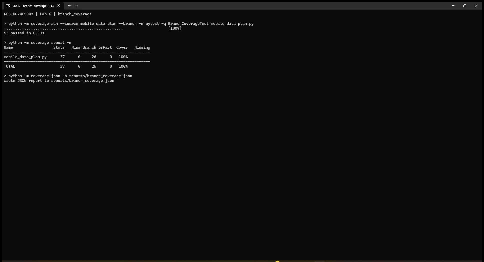

# Lab 6: Code and Branch Coverage Analysis

- **Student:** Akshay V Gudur
- **SRN:** PES1UG24CS047
- **Assigned project:** 45 - Mobile Data Plan
- **Source:** [SETAPESU26/L6_L7_45_mobile_data_plan](https://github.com/SETAPESU26/L6_L7_45_mobile_data_plan), upstream commit `5212351eb03a76757bcf76e02a22416cb6bb7e01`.

The application and two starter tests are unchanged. Two independent test files
exercise the application, and coverage is restricted to `mobile_data_plan.py`
so test code does not inflate the result.

## Measured results

| Stage | Passing tests | Statements covered | Branch outcomes covered | Combined coverage |
| --- | ---: | ---: | ---: | ---: |
| Starter tests, line mode | 2 | 14/37 (37.84%) | Not measured | 37.84% |
| Starter tests, branch mode | 2 | 14/37 (37.84%) | 6/26 (23.08%) | 31.75% |
| Code coverage suite | 13 | 37/37 (100%) | Not measured | 100% |
| Branch coverage suite | 53 | 37/37 (100%) | 26/26 (100%) | 100% |

The branch-mode `Cover` column combines statement and branch outcomes. Initially
it is `(14 + 6) / (37 + 26) = 31.75%`, rounded to 32% in the terminal. Pure
branch coverage is `6 / 26 = 23.08%`. The final suite has no missing statements,
missing branches, partial branches, or excluded lines.

## Coverage analysis and test design

Line coverage measures whether each executable statement ran. Branch coverage
measures whether each measured decision outcome ran. Executing every statement
alone does not generally establish that every decision outcome was tested.

The initial tests only exercise a standard plan within its allowance and an
ordinary permitted recharge. They leave validation failures, overage rates,
loyalty adjustments, large-usage surcharges, recharge rejection, and validity
classification largely untested.

`CodeCoverageTest_mobile_data_plan.py` adds 13 cases covering every application
statement, including both validation errors, normal and roaming overage rates,
large overage surcharges, recharge decisions, and all three validity results.

`BranchCoverageTest_mobile_data_plan.py` independently adds 53 cases:

- Overage: unknown plans, negative usage, zero/fractional usage, each plan's
  allowance, loyalty on/off including premium, roaming on/off, and exactly
  10 versus 11 extra GB (including the loyalty-adjusted boundary).
- Recharge: 199/200/201 with KYC pending; 1999/2000/2001 without pending KYC;
  pending recharge counts 1/2/3; and KYC precedence over the pending count.
- Validity: all four prepaid/add-on combinations; one day above and exactly
  at the active cutoff; one day below it; exactly at the 15-day grace boundary;
  and one day below the grace boundary.

All cases assert a concrete expected charge, boolean, status, or exception.
Full measured branch coverage does not prove all possible paths, input values,
or individual conditions inside compound boolean expressions are tested.

## Reproduce

Use Python 3.12 or newer. From this folder:

```sh
python -m pip install -r requirements.txt
python -m coverage run --source=mobile_data_plan -m pytest -q CodeCoverageTest_mobile_data_plan.py
python -m coverage report -m
python -m coverage run --branch --source=mobile_data_plan -m pytest -q BranchCoverageTest_mobile_data_plan.py
python -m coverage report -m
python -m pytest -q
```

`pytest.ini` enables automatic discovery of the required capitalized test
filenames. The combined run collects 68 tests: 2 starter + 13 code + 53 branch.
To regenerate all saved text and JSON reports, run `python run_coverage.py`.
The runner uses separate coverage data files for every stage to avoid mixing
line and branch measurements.

## Evidence

Only final results exceeding 90% have screenshots. The screenshots below are
actual Windows Terminal captures of the code and branch coverage runs, supplied
by the student. The text cursor and mouse pointer are absent from the captures.
The matching text and JSON reports retain the measured results. The initial
baseline is provided as text/JSON only.




- [Code coverage terminal output](reports/code_coverage.txt)
- [Branch coverage terminal output](reports/branch_coverage.txt)
- [Code coverage JSON](reports/code_coverage.json)
- [Branch coverage JSON](reports/branch_coverage.json)
- [Initial line coverage](reports/initial_line.txt)
- [Initial branch coverage](reports/initial_branch.txt)

## Commit structure

1. Code coverage tests, line-coverage report, and final code-coverage screenshot.
2. Branch coverage tests, branch-coverage report, and final branch-coverage screenshot.

No Lab 7 handout was supplied; this submission covers Lab 6.
