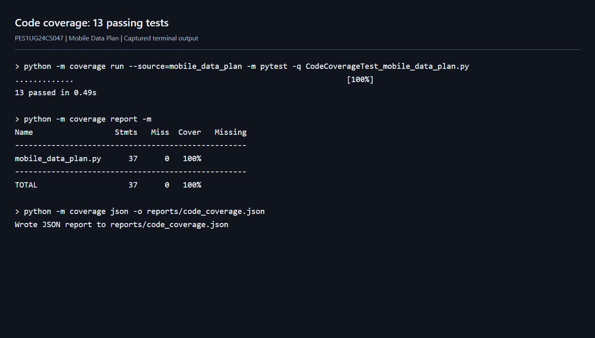

# Lab 6: Code Coverage - Mobile Data Plan

Student: Akshay V Gudur (PES1UG24CS047)

Assigned repository: https://github.com/SETAPESU26/L6_L7_45_mobile_data_plan
Upstream commit: 5212351eb03a76757bcf76e02a22416cb6bb7e01

The original application and starter tests are unchanged.

The two starter tests covered 14/37 statements (37.84%). The 13 cases in
`CodeCoverageTest_mobile_data_plan.py` cover all 37 statements (100%).
Tests include validation errors, overage pricing, loyalty, roaming, large
usage, recharge eligibility, and active/grace/expired validity.

Run from this folder:

```sh
python -m pip install -r requirements.txt
python -m coverage run --source=mobile_data_plan -m pytest -q CodeCoverageTest_mobile_data_plan.py
python -m coverage report -m
```



The image shows verbatim captured terminal output rendered in a browser;
it is not a native terminal-window capture. Raw output and coverage JSON
are in `reports/`. Only final coverage has a screenshot.

This is the code-coverage commit. The branch suite is added separately.
